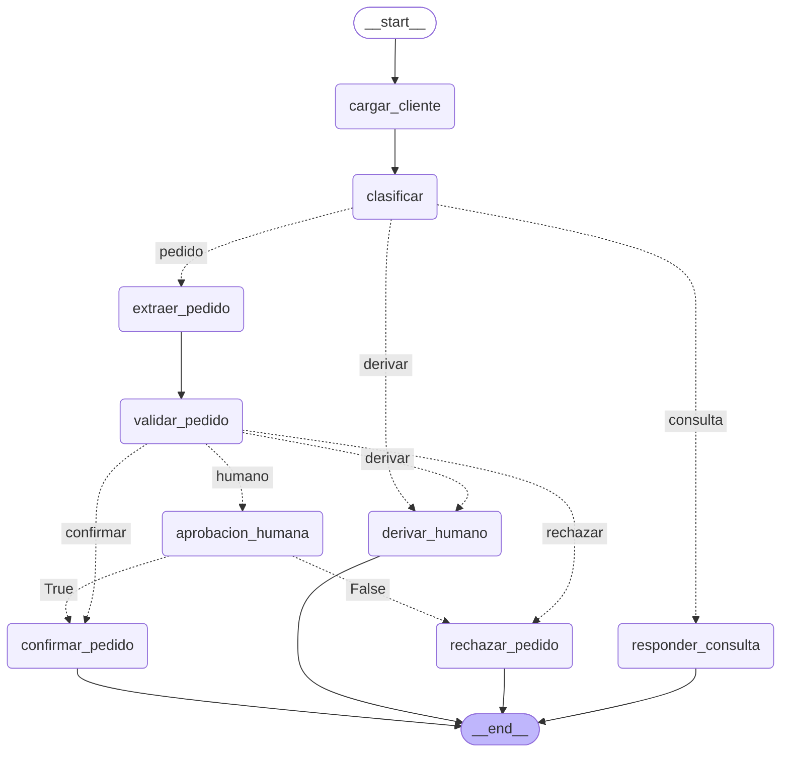

# Informe — Mesa de Pedidos (Desafío 1)

Sistema que procesa los mensajes de clientes de Ferretería Industrial Andina: clasifica, responde
consultas con las políticas (citando documento y página), arma y valida pedidos contra el
catálogo y la cuenta corriente, y frena para pedir aprobación a Gerencia cuando la decisión no le
corresponde.

> **Estado del documento:** estructura. Se completa después de la medición (`evaluar.py`) y se
> entrega en PDF (dos carillas).

---

## 1. Cómo se desarrolló

**La decisión.** El sistema se construyó con un agente de código (Claude Code). El código lo
escribió el agente; las decisiones, el diseño y la validación fueron míos. Lo elegí así para
invertir el tiempo en lo que el desafío evalúa —entender RAG, tools, grafo, estado e `interrupt`,
y cómo se arma un sistema con agentes— en lugar de aprender Python a fondo, que hubiera llevado
mucho más tiempo sin sumar a esos conceptos.

**El ciclo de cada pieza.** El agente no implementaba nada sin que yo lo hubiera razonado antes.
Para cada pieza (un nodo, una tool, una regla) seguimos los mismos pasos:

- **Razonar:** explicaba con mis palabras qué recibe, qué decide, qué devuelve y qué pasa cuando
  falla. El agente evaluaba ese razonamiento contra la consigna, la política y casos reales de la
  bandeja, y cuando había un hueco me devolvía una contrapregunta en lugar de la respuesta.
- **Acordar el contrato:** una tabla corta con entradas, salidas, campos del estado y forma de
  fallar, que yo confirmaba antes de escribir código.
- **Implementar y leer:** el agente escribía el código mínimo y después lo recorríamos bloque por
  bloque, mapeando cada paso de mi explicación a las líneas que lo cumplen.
- **Predecir y ejecutar:** antes de correr, decía qué esperaba ver (qué rama, qué campos, qué
  cita). La diferencia entre predicción y resultado era lo que había que entender.
- **Cerrar con preguntas** de concepto y de "qué pasa si…", sin mirar el código.

**Qué me dejó.** Varias decisiones salieron de equivocarme en la predicción. Predije que MSG-017
(mora de 95 días) iba a `derivar` y la política dice "sin excepción": rechazo. Probé chunks más
grandes para arreglar una consulta de fletes y rompí otra; lo que resolvió los dos casos fue
cortar por sección. En la clasificación, las correcciones fueron acotar frases que le delegaban
un juicio al LLM. Todo eso quedó registrado en [BITACORA.md](BITACORA.md): las definiciones
tomadas de la política, cada decisión técnica con su porqué y las alternativas descartadas, los
conceptos aplicados y lo que quedó fuera de alcance.

---

## 2. Cómo correrlo

Ver el [README](../README.md): instalación, configuración (embeddings locales o por API) y
cómo probar el grafo.

---

## 3. El grafo

> Pendiente: una línea por nodo (con LLM o sólo código, y qué escribe en el estado).

---

## 4. Decisiones y por qué

> Pendiente de redactar. Detalle completo en [BITACORA.md](../BITACORA.md). Puntos a cubrir:

- **Qué nodo lleva LLM:** texto libre → LLM con structured output; datos y reglas → código.
  `validar_pedido` va sin LLM.
- **Chunking por sección** (1000/150): por qué no alcanzó cortar por tamaño (1000 y 1500).
- **Qué dispara aprobación:** mora 30-60, crédito, plazo, descuento pedido sobre el tope y stock
  insuficiente (cambió de `derivar` a `humano` con la medición: MSG-016).
- **Payload de la aprobación:** todas las alertas y los números con que se decidió.
- **Interpretaciones de la política:** monto neto, descuento total.

---

## 5. Resultados

> Pendiente: se completa con `evaluar.py` (`evaluacion.json`).

| Medida | Resultado |
|---|---|
| Mensajes que salieron por la rama correcta | — / 20 |
| Consultas con el dato clave | — / 8 |

- **Casos que fallan y por qué:** —
- **Qué llevó más tiempo:** —

---

## 6. Fuera de alcance

> Pendiente de redactar. Lista completa en [BITACORA.md](../BITACORA.md), sección 9.
