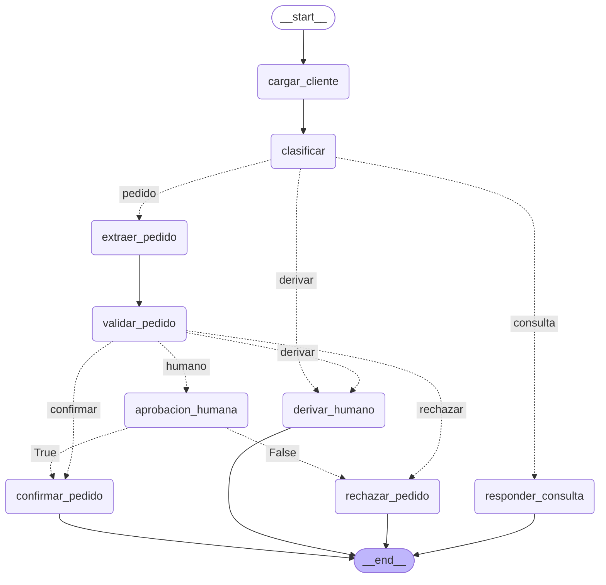

# Mesa de Pedidos — Desafío 1

Sistema que procesa los mensajes de clientes de Ferretería Industrial Andina con un grafo de
LangGraph. Hace cuatro cosas:
- clasifica cada mensaje;
- responde las consultas con las políticas, citando documento y página;
- valida los pedidos contra el catálogo y la cuenta corriente;
- frena para pedir aprobación a Gerencia cuando la decisión no le corresponde.

- Informe: [INFORME.md](INFORME.md) (se entrega en PDF).
- Definiciones y decisiones: [BITACORA.md](BITACORA.md).

---

## 1. Requisitos

- Python 3.11 o superior.
- Una clave de API del proveedor de LLM: **Groq** (por defecto, tiene plan gratuito) u **OpenAI**.
- Para los embeddings, una de dos:
  - **Locales** (por defecto): `BAAI/bge-m3` corre en tu máquina. No necesita clave. La primera
    vez descarga el modelo (~2,3 GB) y en CPU indexar tarda alrededor de un minuto.
  - **Por API**: `text-embedding-3-small` de OpenAI. Necesita `OPENAI_API_KEY` y es pago,
    pero indexar cuesta menos de un centavo de dólar.

## 2. Instalación

```
python -m venv .venv
.venv\Scripts\activate              # Windows (en Linux/Mac: source .venv/bin/activate)
pip install -r requirements.txt
copy .env.example .env              # en Linux/Mac: cp .env.example .env
```

`requirements.txt` instala todo. Si sólo vas a usar embeddings por API, podés comentar el bloque
"Embeddings locales" (`langchain-huggingface`, `sentence-transformers`, `torch`, `hf_xet`)
antes de instalar. Ese bloque es el más pesado.

## 3. Configuración (`.env`)

Elegí una de estas combinaciones y completá sólo la clave del proveedor que uses.

| Combinación | Variables |
|---|---|
| **Groq + embeddings locales** (por defecto) | `PROVEEDOR_LLM=groq` · `MODELO=openai/gpt-oss-120b` · `PROVEEDOR_EMBEDDINGS=huggingface` · `MODELO_EMBEDDINGS=BAAI/bge-m3` · `GROQ_API_KEY=...` |
| Groq + embeddings por API | lo anterior, con `PROVEEDOR_EMBEDDINGS=openai` · `MODELO_EMBEDDINGS=text-embedding-3-small` · `OPENAI_API_KEY=...` |
| Todo OpenAI | `PROVEEDOR_LLM=openai` · `MODELO=gpt-4o-mini` · `PROVEEDOR_EMBEDDINGS=openai` · `MODELO_EMBEDDINGS=text-embedding-3-small` · `OPENAI_API_KEY=...` |

- Con embeddings locales, `DISPOSITIVO_EMBEDDINGS=cuda` usa la GPU si la hay. El valor por
  defecto es `cpu`.
- Cada modelo de embeddings tiene su propio índice, en `artifacts/indice_faiss/<proveedor>_<modelo>`.
  Al cambiar de modelo se construye uno nuevo la primera vez, y los índices de dos modelos nunca
  se mezclan.
- Groq cambia su catálogo de modelos cada tanto: https://console.groq.com/docs/models

## 4. Probar el grafo

Todos los comandos se corren desde la raíz del repo, con el entorno activado:

```
.venv\Scripts\Activate.ps1        # PowerShell (cmd: .venv\Scripts\activate · Linux/Mac: source .venv/bin/activate)
```

Si PowerShell no deja correr el script de activación:
`Set-ExecutionPolicy -Scope Process RemoteSigned` y repetir. Sin el entorno activado aparece
`No module named 'langchain'`.

### Menú interactivo: `correr.py`

La forma más simple de ver el sistema funcionando:

```
python correr.py
```

```
=== Mesa de Pedidos ===
  1. MSG-001  Hola! Consulta: si les compro por 1.200.000 mas IVA, que des...  [terminado]
  ...
 13. MSG-013  Necesitamos con urgencia: 3 amoladoras HE-4180, 1 compresor ...  [FRENADO]
  ...
  b. borrar todos los checkpoints   q. salir

Elegí un número:
```

| Opción | Qué hace |
|---|---|
| `1` a `20` | Procesa ese mensaje: valida el CUIT (si no está en `clientes.csv`, lo rechaza sin arrancar el grafo), corre el grafo y muestra el log, la respuesta con sus citas y, si se frena, lo que ve Gerencia |
| `s` / `n` / Enter | Cuando un pedido se frena: Gerencia aprueba (→ `confirmar_pedido`), rechaza (→ `rechazar_pedido`) o lo deja pendiente |
| `b` | Borra todos los checkpoints para correr todo de cero |
| `q` | Salir |

La situación de cada mensaje sale de los checkpoints (`artifacts/checkpoints.sqlite`, un thread
por mensaje): vacío = sin correr, `[FRENADO]` = esperando a Gerencia, `[terminado]` = ya
procesado. Un mensaje terminado no se vuelve a correr (su log se duplicaría): se muestra lo
guardado. Para correrlo de nuevo, `b`.

**Probar que se puede retomar después de cerrar la terminal:**

1. `python correr.py` → elegir `14` (MSG-014 supera el crédito y se frena).
2. Enter (dejar pendiente) → `q`.
3. Cerrar la terminal, abrir otra, activar el entorno y correr `python correr.py`:
   MSG-014 aparece `[FRENADO]`.
4. Elegir `14` → `s`. El grafo sigue desde `aprobacion_humana` (no vuelve a clasificar ni a
   llamar al LLM) y termina en `confirmar_pedido`.

**Un mensaje de cada camino:**

| Mensaje | Camino |
|---|---|
| MSG-002 | consulta → `responder_consulta` |
| MSG-009 | pedido → `confirmar_pedido` |
| MSG-013, 014, 015 | pedido → `aprobacion_humana` (se frena) |
| MSG-016 | pedido → `derivar_humano` (sin stock) |
| MSG-017 | pedido → `rechazar_pedido` (mora de 95 días en cuenta corriente) |
| MSG-019 | derivar desde `clasificar` (proveedor) |

### Por línea de comandos: `scripts/`

**El grafo, sin menú** (comparte los checkpoints con `correr.py`):

```
python -m scripts.probar_grafo                      # los 20 mensajes de la bandeja
python -m scripts.probar_grafo MSG-009 MSG-013      # sólo esos
python -m scripts.probar_grafo --dibujar            # el grafo en mermaid
python -m scripts.probar_grafo --borrar MSG-013     # borra los checkpoints y corre de cero
```

**Frenar, aprobar y retomar:**

```
python -m scripts.probar_grafo --borrar MSG-013     # se frena: muestra el payload para Gerencia
#   ... se puede cerrar la terminal ...
python -m scripts.probar_grafo MSG-013 --retomar si # Gerencia aprueba → confirmar_pedido
python -m scripts.probar_grafo MSG-015 --retomar no # Gerencia rechaza → rechazar_pedido
```

Cuando un mensaje ya tiene thread, el script no lo vuelve a correr: muestra lo que quedó
guardado. Para correrlo de nuevo, usá `--borrar`.

Los mensajes que pasan por Gerencia son MSG-013, MSG-014 y MSG-015.

**Piezas sueltas:**

```
python -m scripts.probar_rag "cuánto sale el flete a Neuquén"   # una consulta al RAG
python -m scripts.probar_rag "..." --reindexar                  # reconstruye el índice (si cambian los PDF)
python -m scripts.probar_clasificar [MSG-004 ...]               # sólo la clasificación
```

La primera consulta construye el índice y las siguientes lo reutilizan.

> Pendiente: `evaluar.py` (los 20 casos contra el golden set, con salida en `evaluacion.json`).

## 5. Estructura

```
mesa_pedidos/   config, modelos, rag, datos, tools, estado, nodos, grafo
correr.py       menú para procesar mensajes y aprobar/rechazar
scripts/        pruebas manuales (probar_rag, probar_clasificar, probar_grafo)
data/           políticas (PDF), catálogo, clientes y bandeja
consigna/       consigna y golden set
artifacts/      índice FAISS y checkpoints (no se versiona: se regenera)
```

## 6. El grafo


